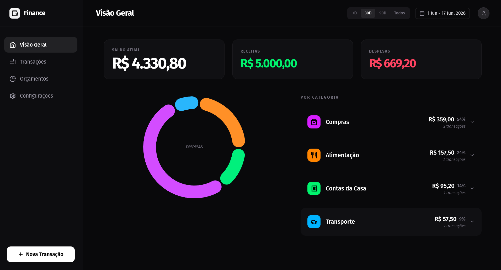
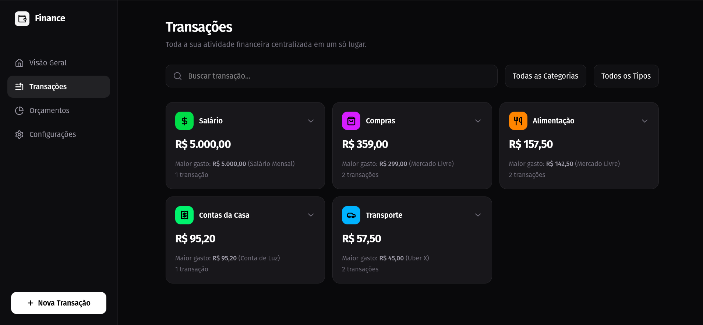
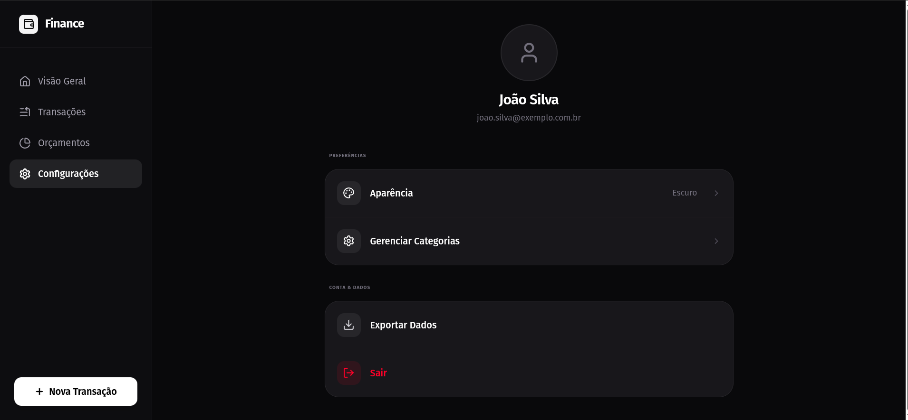
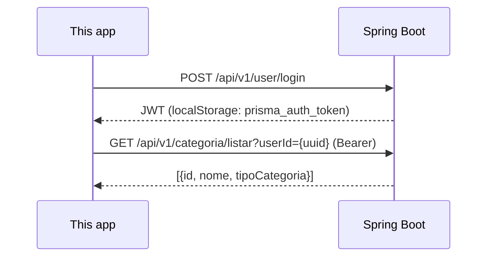

# Prisma Finance frontend — finance panel (React)

Open source frontend for Prisma Finance: landing page, authentication, and a dark finance panel to track income, expenses, and categories.

This is the `frontend` service from the repo root. The backend contract lives in `Back-end/.../controllers/` and the full stack guide in `../../README.md`.

## Screens

### Landing + authentication

Fintech landing with **login** and **register** links (JWT + BCrypt on the backend). A logged-in user skips the landing and goes straight to the panel.

### Overview (dashboard)

Current balance, income, expenses, net savings, and spending-by-category donut.


### Transactions

Full list with colored categories, search, and filters.


### Categories and settings

Manage categories with custom colors (expenses and income) and edit your profile.


## Stack

| Layer | Technology |
|-------|------------|
| UI | React 19 + TypeScript |
| Build | Vite 6 |
| Styling | Tailwind CSS 4 + shadcn/ui |
| Icons | Lucide React |
| Charts | Recharts |
| Animations | Motion (Framer Motion) |
| Fonts | Geist Variable, Space Grotesk Variable |

Config: `package.json`, `vite.config.ts`, `components.json`, `tsconfig.json`.

## How it fits in the system

```mermaid
flowchart LR
  Browser -->|":3000 dev, :80 prod (Nginx)"| UI["This app\nReact SPA"]
  UI -->|"`VITE_API_URL`/api/v1/*\nBearer JWT"| API["Spring Boot :8080"]
  API --> DB[("PostgreSQL")]
```



Entry `src/main.tsx` renders `src/App.tsx`:

- Public hash routes (`App.tsx:21-26`): `/` renders `landing/LandingPage.tsx`; `#/login` and `#/cadastro` render `auth/AuthPage.tsx`.
- Authenticated tabs (`App.tsx:66-86`): `home` renders `dashboard/HomePage.tsx`, `transactions` renders `transactions/TransactionsPage.tsx`, `categories` renders `categories/CategoriesPage.tsx`, `profile` renders `profile/ProfilePage.tsx`. Shell uses `layout/` and `tinta/TintaSidebar.tsx`.
- Providers in `App.tsx:115-127`: `AuthProvider` (`auth/AuthContext.tsx`) > `FinanceProvider` (`finance/FinanceContext.tsx`) > `TransactionFormProvider` (`finance/TransactionFormContext.tsx`) > `ToastProvider` (`shared/components/Toast.tsx`).

## State and services

- `finance/FinanceContext.tsx` holds `expenses`, `categories`, `loading`, `totalIncome`, `totalExpense`, `balance`.
- Categories are backend-backed with a `localStorage` fallback (`FinanceContext.tsx:40-66`). The UI maps `expense/income` to `Despesas/Receita` before sending (`FinanceContext.tsx:89-93`).
- Expenses are browser-only: `shared/services/financeService.ts:8-28` uses keys `finance_dashboard_expenses` and `finance_dashboard_expense_seq`, plus `finance_dashboard_categories` for the fallback cache.
- `shared/services/categoriesApi.ts:61-143` calls the backend with `Authorization: Bearer <token>` from `prisma_auth_token`:

| Function | Request |
|----------|---------|
| `listar(userId)` | `GET /api/v1/categoria/listar?userId={uuid}` |
| `criar(payload)` | `POST /api/v1/categoria/criarCategoria` `{nome, tipoCategoria, userId}` |
| `atualizar(id, payload)` | `PUT /api/v1/categoria/atualizarLista?id={id}` `{id, nome, tipoCategoria}` |
| `deletar(id)` | `DELETE /api/v1/categoria/deletar?id={id}` |

- Token helpers: `shared/utils/token.ts` (reads user UUID from JWT `sub`), `shared/utils/formatters.ts` (BRL formatting), `shared/types/index.ts` (`Expense`, `CategoryInfo`, `Tab`), `shared/constants/index.ts` (defaults).
- `telegram/` dispatches `prisma:telegram-expense` events merged into state in `FinanceContext.tsx:30-38`. `tinta/` holds dashboard widgets (`KpiStrip`, `CategoryDonutTinta`, `RecentTinta`, `BalanceHistoryTinta`, and others).

## Run locally

**Prerequisites:** Node.js (or Docker for the full stack).

1. Install dependencies:
   ```bash
   npm install
   ```
2. Configure `.env` from the example (set `VITE_API_URL`):
   ```bash
   cp .env.example .env
   ```
3. Start the dev server:
   ```bash
   npm run dev
   ```
   Open `http://localhost:3000` (landing at `/`; login at `/#/login`; register at `/#/cadastro`).

### Production build

```bash
npm run build       # generates dist/ (consumes VITE_API_URL)
npm run preview     # serves the build locally
```

### Type check

```bash
npm run lint        # tsc --noEmit
```

### Docker

```bash
# From the repo root (Prisma), with backend + database:
docker compose up --build -d
# Frontend served at http://localhost (Nginx)
```

The image builds in two stages (`Dockerfile:1-41`): Node 20 builds `dist/`, then Nginx serves it with SPA fallback `try_files $uri $uri/ /index.html`.

## Scripts

| Command | Description |
|---------|-------------|
| `npm run dev` | Dev server on port 3000 (`--host=0.0.0.0`) |
| `npm run build` | Production build (Vite) |
| `npm run preview` | Serve the build locally |
| `npm run lint` | Type check (`tsc --noEmit`) |
| `npm run clean` | Remove `dist` artifacts |

## Folder structure

```text
src/
├── main.tsx / App.tsx / index.css / vite-env.d.ts
├── landing/          # Landing page (components + content)
├── auth/             # AuthPage + AuthContext
├── dashboard/        # HomePage + DonutChart
├── transactions/    # TransactionsPage + AddTransactionForm
├── categories/       # CategoriesPage
├── finance/          # FinanceContext + TransactionFormContext (+ useFinance)
├── shared/           # components, types, services, constants, utils
├── layout/           # SiteHeader + AppSidebar
├── tinta/            # Dashboard widgets (KpiStrip, donuts, history, sidebar, pickers)
├── profile/          # ProfilePage
└── telegram/         # Telegram expense intake
```

UI primitives live in `components/ui/` (aliased as `@/` in `vite.config.ts:10-14`). Static assets live in `public/`.

## Environment variables

| Variable | Description | Default |
|----------|-------------|---------|
| `VITE_API_URL` | Base URL of the Spring Boot API | `http://localhost:8080` |

The `.env.example` file also lists `GEMINI_API_KEY` and `APP_URL`; only `VITE_API_URL` is used by the auth and category calls verified above. The dev server port is fixed in `package.json:7` (`vite --port=3000 --host=0.0.0.0`).

## Open questions

- `telegram/` and `tinta/` have no dedicated docs; behavior above is what the imports and event wiring show.
- Transactions persist only in `localStorage`; there is no `TransacaoController` on the backend to sync them.
- `../../03-budgets.png` exists at the repo root but no budgets route or component was found in `src/`.