# Prisma Finance

> Dashboard financeiro pessoal — dark, rápido e direto ao ponto. Controle receitas, despesas e categorias num painel unificado.


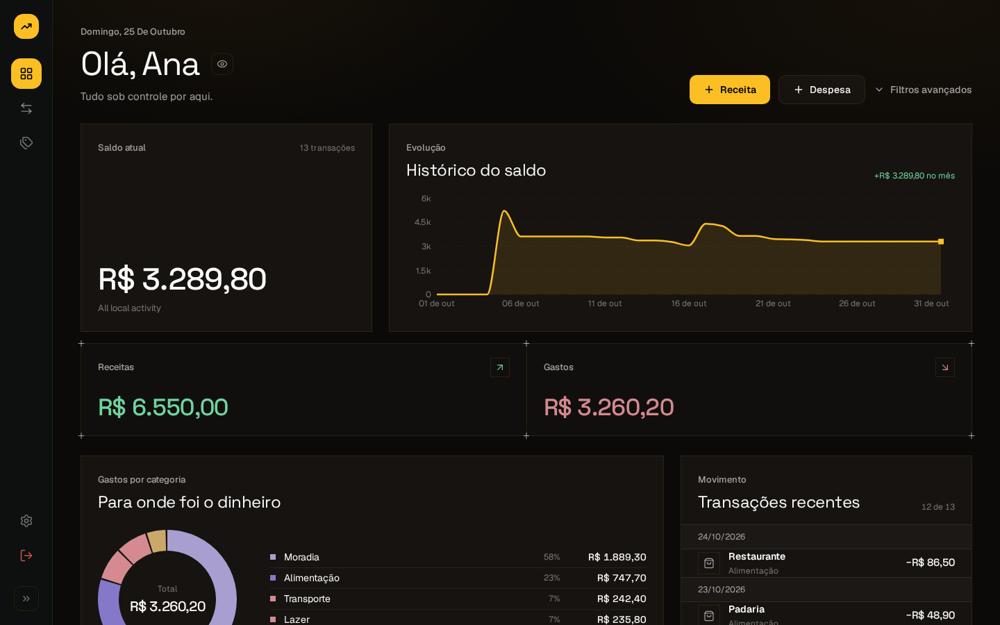

**Sumário:** [Telas](#telas) · [Funcionalidades](#funcionalidades) · [Stack](#stack) · [Arquitetura](#arquitetura) · [API](#api) · [Como rodar](#como-rodar) · [Variáveis de ambiente](#variáveis-de-ambiente)

---

## Telas

> Capturas feitas em outubro de 2026 com dados de exemplo.

### Painel
Saldo atual, histórico do saldo no mês, totais de receitas e gastos, donut de gastos por categoria e transações recentes. O botão de olho esconde os valores.


### Transações
Entradas e saídas agrupadas por categoria, com busca, filtros avançados e lista expansível em cada card ("Ver mais").

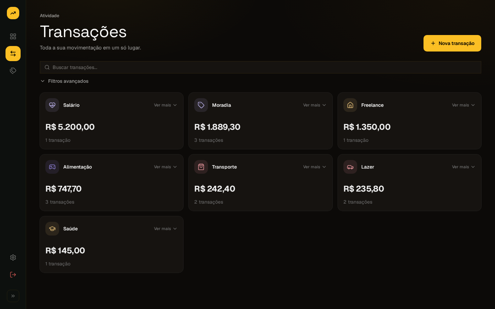

### Categorias
Receitas e despesas com cor e símbolo próprios, total acumulado, participação no total e as transações de cada categoria direto no card.

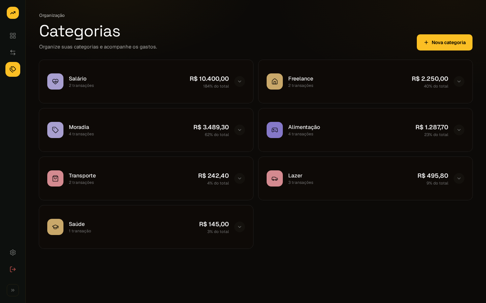

### Configurações
Edição de nome, troca de e-mail e senha, exportação de dados e saída da conta.

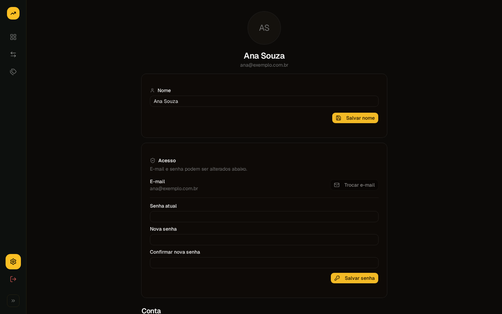

### Landing page e login

| Landing | Login |
|---------|-------|
| 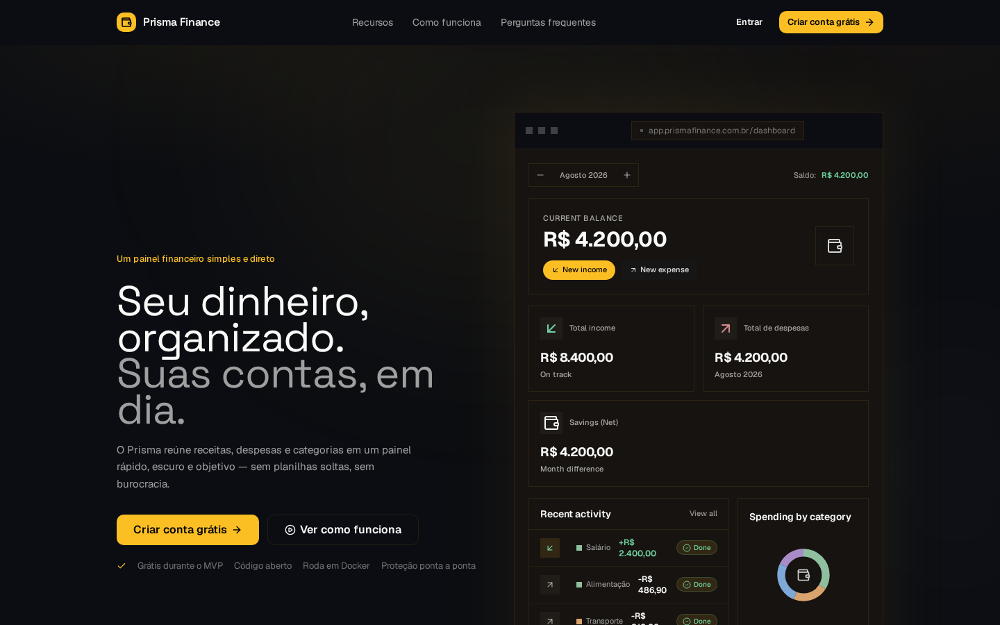 | 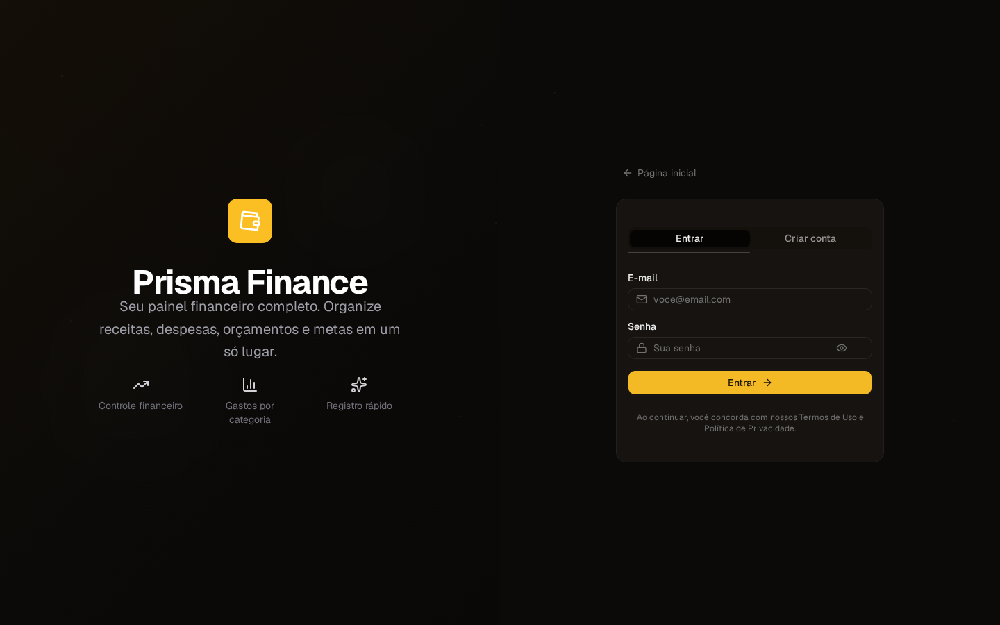 |

### No celular
Layout responsivo com navegação inferior. Pode ser instalado como app (PWA).

<p>
  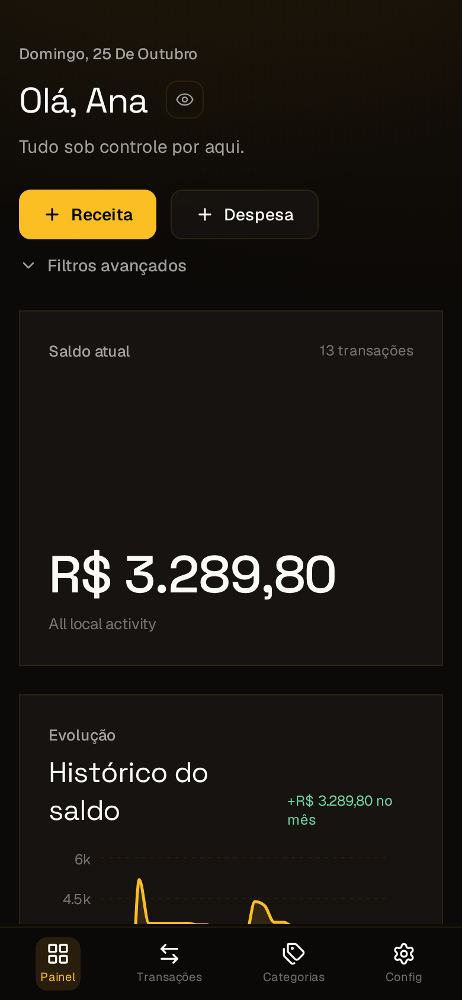
  &nbsp;&nbsp;
  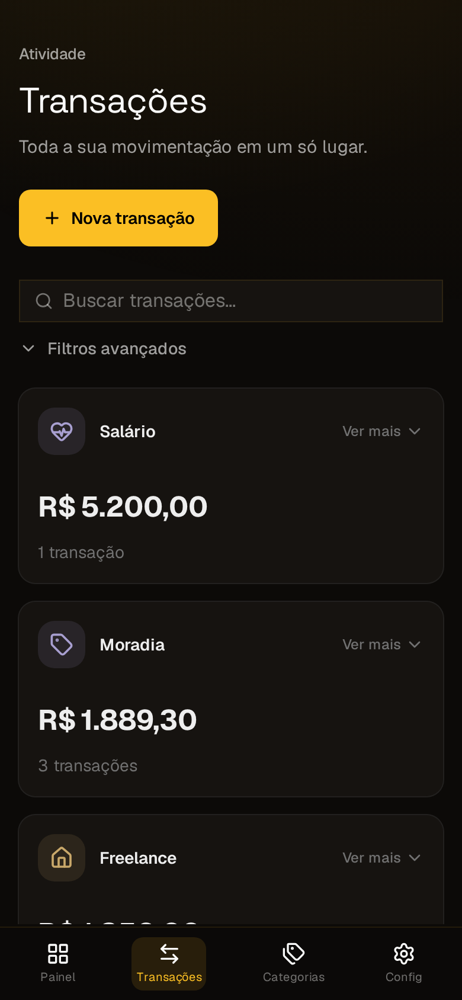
</p>

---

## Funcionalidades

- **Autenticação** — cadastro e login com e-mail e senha. Senhas hasheadas com BCrypt; sessões stateless via JWT Bearer.
- **Dashboard** — saldo atual, receitas, despesas e donut de gastos por categoria.
- **Transações** — CRUD completo sincronizado com o backend. Cache offline em `localStorage`.
- **Categorias** — CRUD com validação de propriedade por usuário. Cores customizáveis salvas localmente.
- **Perfil** — visualização de conta, exportação de dados e logout.
- **PWA** — service worker e app shell offline via `vite-plugin-pwa`.

---

## Stack

| Camada | Tecnologia |
|--------|------------|
| Frontend | React 19 + TypeScript + Vite 6 |
| Estilização | Tailwind CSS 4 + shadcn/ui |
| Ícones | Lucide React |
| Gráficos | Recharts |
| Animações | Motion (Framer Motion) |
| Backend | Java 17 + Spring Boot 4.1.0 + Spring Security |
| Autenticação | `com.auth0:java-jwt 4.4.0` (issuer `Prisma`, subject = UUID do usuário) |
| Banco de dados | PostgreSQL 15 |
| Infra | Docker + Docker Compose + Nginx (SPA) |

---

## Arquitetura

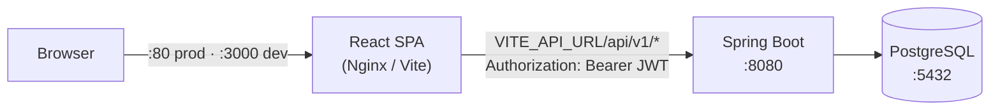

### Serviços Docker

| Serviço | Build / Imagem | Portas |
|---------|----------------|--------|
| `db` | `postgres:15-alpine` | `5433:5432` |
| `backend` | `Back-end/.../Dockerfile` | `8080:8080` |
| `frontend` | `Front-end/.../Dockerfile` (Node 20 → Nginx) | `80:80` |

### Fluxo de autenticação

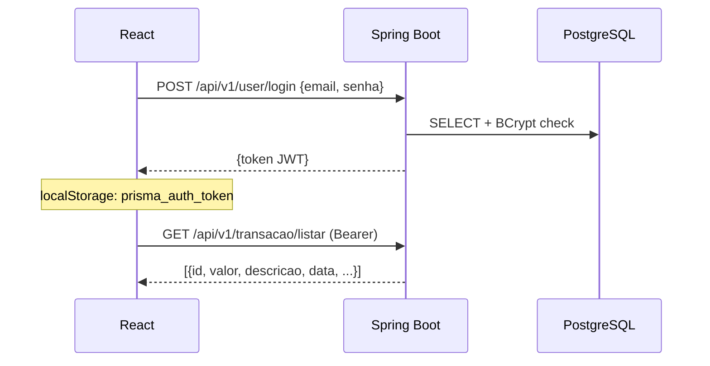

---

## API

Base URL: `http://localhost:8080` (variável `VITE_API_URL` no frontend).
Todas as rotas exceto `/registrar` e `/login` exigem `Authorization: Bearer <JWT>`.

### Usuários

| Método | Rota | Corpo | Resposta |
|--------|------|-------|----------|
| POST | `/api/v1/user/registrar` | `{nome, email, senha}` | `201` |
| POST | `/api/v1/user/login` | `{email, senha}` | `200 {token}` |

### Categorias

| Método | Rota | Corpo / Query | Resposta |
|--------|------|---------------|----------|
| POST | `/api/v1/categoria/criarCategoria` | `{nome, tipoCategoria, userId}` | `201` |
| GET | `/api/v1/categoria/listar?userId={uuid}` | — | `[{id, nome, tipoCategoria}]` |
| PUT | `/api/v1/categoria/atualizarLista?id={id}` | `{id, nome, tipoCategoria}` | `200` |
| DELETE | `/api/v1/categoria/deletar?id={id}` | — | `201` |

### Transações

| Método | Rota | Corpo / Query | Resposta |
|--------|------|---------------|----------|
| POST | `/api/v1/transacao/criar` | `{valor, descricao, data (dd/MM/yyyy), categoria_id, user_id?, observacao?}` | `201 {id}` |
| GET | `/api/v1/transacao/listar` | — | `[{id, valor, descricao, data, categoria_id, categoria_nome, categoria_tipo, observacao}]` |
| POST | `/api/v1/transacao/atualizar` | `{id, valor, descricao, data, categoria_id, observacao?}` | `200 {transacao}` |
| DELETE | `/api/v1/transacao/deletar?id={id}` | — | `204` |

---

## Modelo de dados

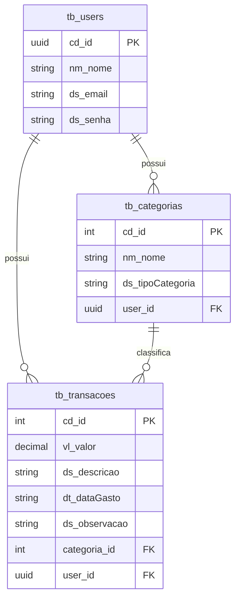

Schema gerenciado automaticamente pelo Hibernate (`ddl-auto=update`).

---

## Como rodar

### Opção 1 — Docker (recomendado)

```bash
# 1. Clone o repositório
git clone <seu-fork>
cd Prisma

# 2. Configure as variáveis de ambiente
cp .env.example .env
cp Front-end/DashboardFinanceiroFrontEnd/.env.example Front-end/DashboardFinanceiroFrontEnd/.env

# 3. Suba tudo
docker compose up --build -d
```

| Serviço | URL |
|---------|-----|
| Frontend | http://localhost |
| API | http://localhost:8080 |
| Banco (externo) | `localhost:5433` |

### Opção 2 — Desenvolvimento local

```bash
# Backend (na pasta do projeto Spring Boot)
./mvnw spring-boot:run

# Frontend (em Front-end/DashboardFinanceiroFrontEnd)
npm install
npm run dev   # http://localhost:3000
```

Rotas do frontend: `/` → landing · `/#/login` → login · `/#/cadastro` → cadastro.

---

## Variáveis de ambiente

### Backend — `.env` (raiz do repositório)

```bash
KEY_POSTGRES_PORT=5432
KEY_POSTGRES_DATABASE_NAME=prisma
KEY_POSTGRES_USER=SEU_USUARIO
KEY_POSTGRES_PASSWORD=SUA_SENHA
JWT_SECRET=SEU_SECRET_JWT
TIME_EXPIRATION_DTO=7200
CORS_ALLOWED_ORIGINS="http://localhost:3000,http://localhost"
```

> Em produção via Docker Compose o banco usa credenciais hardcoded (`postgres/postgres`). Os valores `KEY_*` acima se aplicam ao `./mvnw spring-boot:run` local.

### Frontend — `Front-end/DashboardFinanceiroFrontEnd/.env`

```bash
VITE_API_URL="http://localhost:8080"
```

---

## Estrutura do projeto

```text
Prisma/
├── docs/screenshots/          # Capturas de tela usadas neste README
├── docker-compose.yml
├── .env.example
├── Back-end/Sistema para controle Financeiro/Sistema-para-controle-Financeiro/
│   └── src/main/java/com/KeepFlow/.../
│       ├── controllers/          # UserController, CategoriaController, TransacaoController
│       ├── services/
│       │   ├── autenticacao/     # login, register, TokenServices
│       │   ├── categorias/       # CategoriaService
│       │   └── transacao/        # TransacaoService
│       ├── domain/               # User, Categoria, Transacao (JPA entities)
│       ├── repository/           # Spring Data interfaces
│       └── infra/                # security/, cors/, customExceptions/
└── Front-end/DashboardFinanceiroFrontEnd/
    ├── src/
    │   ├── App.tsx / main.tsx / index.css
    │   ├── landing/ auth/ dashboard/ transactions/ categories/ profile/
    │   ├── finance/              # FinanceContext, TransactionFormContext
    │   ├── shared/               # components, types, services, utils, constants
    │   ├── layout/               # SiteHeader, AppSidebar
    │   └── tinta/                # Widgets do dashboard (KpiStrip, DonutChart, etc.)
    └── README.md                 # Guia exclusivo do frontend
```

---

## Segurança

- Senhas com `BCryptPasswordEncoder`.
- Sessões stateless — CSRF desabilitado, JWT validado pelo `SecurityFilter` antes de cada requisição autenticada.
- Todas as operações de categoria e transação validam que o recurso pertence ao usuário autenticado (via `SecurityContextHolder`).
- CORS configurado em `infra/cors/Cors.java` (atualmente fixo em `http://localhost:3000` para desenvolvimento).

---

*Prisma Finance · 2026 · open source*
