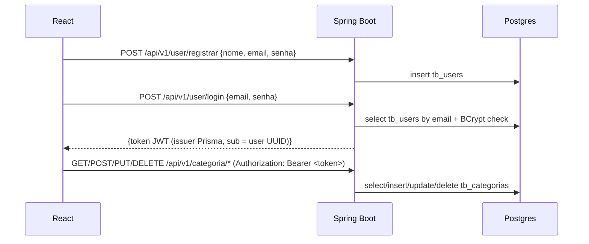
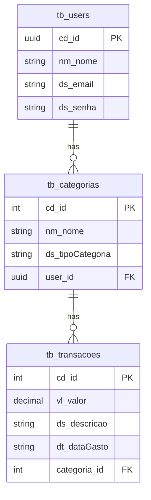

# Prisma Finance — personal finance panel

> Open source tool to track income, expenses, and categories in a fast, dark, straight-to-the-point panel.


---

## What it does

- **Landing page** with fintech identity and links to login and registration.
- **Authentication** with email and password. Passwords are hashed with BCrypt, sessions use JWT Bearer tokens.
- **Dashboard** (`home` tab): current balance, income, expenses, net savings, spending-by-category donut, and recent activity.
- **Transactions** (`transactions` tab): income and expense entries in BRL, colored category cards, search and filters. Persisted in the backend (`tb_transacoes`), with a `localStorage` cache for offline use.
- **Categories** (`categories` tab): full CRUD backed by the Spring Boot API. Each category belongs to one user.
- **Profile** (`profile` tab): local user view and settings entry point.

The panel runs in dark mode. All amounts are rendered in BRL.

## Screens

| | |
|---|---|
| Transactions  | Settings  |

> Screenshots reflect the current dark theme. A file `03-budgets.png` also exists in this folder but no budgets screen was found in the code, so it is not referenced here.

---

## Stack

| Layer | Technology |
|-------|------------|
| Frontend | React 19 + TypeScript + Vite 6 |
| Styling | Tailwind CSS 4 + shadcn/ui |
| Icons | Lucide React |
| Charts | Recharts |
| Animations | Motion (Framer Motion) |
| Fonts | Geist Variable, Plus Jakarta Sans, Space Grotesk, Space Mono |
| Backend | Java 17 + Spring Boot 4.1.0 + Spring Security + `com.auth0:java-jwt:4.4.0` |
| Database | PostgreSQL 15 (`tb_users`, `tb_categorias`, `tb_transacoes`) |
| Infra | Docker + Docker Compose, Nginx (static SPA) |

Manifests: `Back-end/Sistema para controle Financeiro/Sistema-para-controle-Financeiro/pom.xml`, `Front-end/DashboardFinanceiroFrontEnd/package.json`, `docker-compose.yml`.

---

## Architecture

```mermaid
flowchart LR
  Browser -->|":80 in prod, :3000 in dev"| Frontend["Frontend\nReact SPA (Nginx / Vite)"]
  Frontend -->|"`VITE_API_URL` + /api/v1/*\nBearer JWT"| Backend["Backend\nSpring Boot :8080"]
  Backend --> DB[("PostgreSQL\n:5432 (host :5433)")]
```

Services in `docker-compose.yml`:

| Service | Image / build | Ports |
|---------|---------------|-------|
| `db` | `postgres:15-alpine` | `5433:5432` |
| `backend` | `./Back-end/Sistema para controle Financeiro/Sistema-para-controle-Financeiro/Dockerfile` | `8080:8080` |
| `frontend` | `./Front-end/DashboardFinanceiroFrontEnd/Dockerfile` (Node 20 build, Nginx serve) | `80:80` |

Request flow:



End-to-end flows verified in code:

1. **Register and login.** `UserController.java:27-37` calls `AutenticacaoRegisterService` and `AutenticacaoLoginService`. `TokenServices.java:19-27` issues a JWT with issuer `Prisma` and subject = user UUID, expiring after `TIME_EXPIRATION_DTO` seconds. The frontend stores it under `prisma_auth_token` and sends it as `Bearer` (`Front-end/.../src/shared/services/categoriesApi.ts:42-59`). Public routes are `#/login` and `#/cadastro` (`Front-end/.../src/App.tsx:21-26`).
2. **Categories.** `CategoriaController.java:22-43` exposes create, list, delete, and update. The frontend maps `expense/income` to `Despesas/Receita` before sending (`Front-end/.../src/finance/FinanceContext.tsx:89-93`) and falls back to `localStorage` when the API is unreachable (`FinanceContext.tsx:58-61`).
3. **Transactions.** `TransacaoController` exposes `POST /api/v1/transacao/criar` (returns the generated `cd_id`) and `GET /api/v1/transacao/listar`. The database is the source of truth; `financeService` (`financeService.ts:8-28`, keys `finance_dashboard_expenses`, `finance_dashboard_categories`) keeps a `localStorage` cache used when the API is unreachable.

---

## API reference

Base URL defaults to `http://localhost:8080`. All category routes require `Authorization: Bearer <JWT>`; only register and login are public (`infra/security/WebSecurityConfig.java:28-39`).

| Method | Path | Body / query | Returns |
|--------|------|--------------|---------|
| POST | `/api/v1/user/registrar` | `{nome, email, senha}` | `201` + `{message}` |
| POST | `/api/v1/user/login` | `{email, senha}` | `200` + `{token, ...}` |
| POST | `/api/v1/categoria/criarCategoria` | `{nome, tipoCategoria, userId}` | `201` + `{message}` |
| GET | `/api/v1/categoria/listar?userId={uuid}` | query `userId` (UUID from JWT `sub`) | `[{id, nome, tipoCategoria, userId}]` |
| PUT | `/api/v1/categoria/atualizarLista?id={id}` | query `id` (integer `cd_id`) + `{id, nome, tipoCategoria}` | `200` + `{message}` |
| DELETE | `/api/v1/categoria/deletar?id={id}` | query `id` (integer `cd_id`) | `201` + `{message}` |
| POST | `/api/v1/transacao/criar` | `{valor, descricao, data: dd/MM/yyyy, categoria_id, user_id, observacao}` | `201` + `{id}` (the `cd_id`) |
| GET | `/api/v1/transacao/listar` | — | `[{id, valor, descricao, data, categoria_id, categoria_nome, categoria_tipo, observacao}]` |

Validation enforced by the domain: password 8–16 chars and email regex (`domain/User.java:45-54`), category name 3–15 chars and `tipoCategoria` equal to `Receita` or `Despesas` (`domain/Categoria.java:55-67`).

---

## Data model



Tables are created with `spring.jpa.hibernate.ddl-auto=update` (`docker-compose.yml:30` and `application.properties:14`). Entity definitions: `domain/User.java:13-28`, `domain/Categoria.java:11-25`, `domain/Transacao.java:19-34`.

---

## Frontend map

Entry: `Front-end/DashboardFinanceiroFrontEnd/src/main.tsx` renders `src/App.tsx`.

- Public: `/` renders `landing/LandingPage.tsx`; `#/login` and `#/cadastro` render `auth/AuthPage.tsx` (`App.tsx:28-51`).
- Authenticated tabs (`App.tsx:66-86`, type `Tab` in `shared/types`): `home` renders `dashboard/HomePage.tsx`, `transactions` renders `transactions/TransactionsPage.tsx`, `categories` renders `categories/CategoriesPage.tsx`, `profile` renders `profile/ProfilePage.tsx`. Shell is `layout/` + `tinta/TintaSidebar.tsx`.
- State: `finance/FinanceContext.tsx` holds `expenses`, `categories`, `totalIncome`, `totalExpense`, `balance`. Expenses are local-only; categories sync with the API above.
- HTTP layer: `shared/services/categoriesApi.ts:61-143` (`listar`, `criar`, `atualizar`, `deletar`). Token helpers: `shared/utils/token.ts`, `shared/services/financeService.ts`.
- Extra folders present in `src/`: `tinta/` (dashboard widgets), `telegram/` (dispatches `prisma:telegram-expense` events consumed in `FinanceContext.tsx:30-38`), `shared/components/`, `shared/constants/`, `shared/utils/formatters.ts`.

See `Front-end/DashboardFinanceiroFrontEnd/README.md` for frontend-only setup, scripts, and folder details.

---

## Run

### Option 1 — Docker (recommended)

```bash
# 1. Clone the repository
git clone <your-repo>
cd Prisma

# 2. Configure backend variables
cp .env.example .env

# 3. Configure frontend variables
cp Front-end/DashboardFinanceiroFrontEnd/.env.example Front-end/DashboardFinanceiroFrontEnd/.env

# 4. Start database, backend, and frontend
docker compose up --build -d
```

Access after `docker compose up`:

| Service | URL |
|---------|-----|
| Frontend (prod, Nginx) | http://localhost |
| Frontend (dev server) | http://localhost:3000 |
| API (Spring Boot) | http://localhost:8080 |
| Database (PostgreSQL) | localhost:5433 |

### Option 2 — Local development (no Docker)

```bash
# Backend — from the backend folder
./mvnw spring-boot:run

# Frontend — from Front-end/DashboardFinanceiroFrontEnd
npm install
npm run dev
```

Open `http://localhost:3000`. The landing page is at `/`; login is at `/#/login`; registration is at `/#/cadastro`. The frontend reads the API base from `VITE_API_URL` (default `http://localhost:8080`).

---

## Environment variables

### Root `.env` — backend

Read by `src/main/resources/application.properties:10-20` (plus `SPRING_DATASOURCE_*` overrides in `docker-compose.yml:26-31`).

```bash
KEY_POSTGRES_PORT=5432
KEY_POSTGRES_DATABASE_NAME=prisma
KEY_POSTGRES_USER=YOUR_USER
KEY_POSTGRES_PASSWORD=YOUR_PASSWORD
JWT_SECRET=YOUR_SECURE_JWT_SECRET
TIME_EXPIRATION_DTO=7200
CORS_ALLOWED_ORIGINS="http://localhost:3000,http://localhost"
```

> Note: `docker-compose.yml` currently hardcodes `POSTGRES_USER: postgres`, `POSTGRES_PASSWORD: postgres`, and `POSTGRES_DB: prisma_db`, and overrides the datasource URL, username, and password. The `KEY_*` values above apply to local `./mvnw` runs; the compose database uses the hardcoded values.

### Frontend `.env` — `Front-end/DashboardFinanceiroFrontEnd/.env`

```bash
VITE_API_URL="http://localhost:8080"
```

The example file also documents `GEMINI_API_KEY` and `APP_URL`; only `VITE_API_URL` is consumed by the category and auth calls verified above.

---

## Security

- Passwords hashed with `BCryptPasswordEncoder` (`infra/security/Security.java:12-13`).
- Stateless sessions: CSRF disabled, `SessionCreationPolicy.STATELESS`, JWT checked by `SecurityFilter` before `UsernamePasswordAuthenticationFilter` (`infra/security/WebSecurityConfig.java:21-43`, `infra/security/SecurityFilter.java:51-52`).
- CORS: `infra/cors/Cors.java:16-24` registers `/**` with `allowedOrigins("http://localhost:3000")`. The `CORS_ALLOWED_ORIGINS` variable is injected but not used in the mapping, so non-`localhost:3000` origins are not allowed by the running code.
- To serve over HTTPS in production (certificates, Nginx TLS, redirect, renewal), follow [SEGURANCA_HTTPS.md](./SEGURANCA_HTTPS.md).

---

## Project structure

```text
Prisma/
├── 01-dashboard.png / 02-transactions.png / 03-budgets.png / 04-settings.png
├── docker-compose.yml                  # db + backend + frontend
├── .env.example                        # backend keys (see above)
├── SEGURANCA_HTTPS.md                  # TLS guide for production
├── Back-end/Sistema para controle Financeiro/Sistema-para-controle-Financeiro/
│   └── src/main/java/com/KeepFlow/Sistema/para/controle/Financeiro/
│       ├── controllers/UserController.java / CategoriaController.java
│       ├── services/autenticacao/ (login, register, TokenServices)
│       ├── services/categorias/CategoriaService.java
│       ├── domain/User.java / Categoria.java / Transacao.java
│       ├── repository/UserRepository.java / CategoriaRepository.java
│       └── infra/security/ + infra/cors/ + infra/customExceptions/
└── Front-end/DashboardFinanceiroFrontEnd/
    ├── src/App.tsx / main.tsx
    ├── src/landing/ / auth/ / dashboard/ / transactions/ / categories/
    ├── src/finance/ / shared/ / layout/ / tinta/ / profile/ / telegram/
    ├── Dockerfile                      # Node 20 build + Nginx SPA fallback
    └── README.md                       # frontend-only guide
```

---

## Verification

```bash
# Frontend type check (from Front-end/DashboardFinanceiroFrontEnd)
npm run lint        # tsc --noEmit

# Production build
npm run build       # vite build -> dist/ (consumes VITE_API_URL)

# Full stack
docker compose up --build -d
docker compose ps
```

---

## Open questions

- `03-budgets.png` exists in the repo root but no budgets UI, route, or table was found in the code.
- `tb_transacoes` exists as a JPA entity but has no controller, service, or repository, and its constructor stores nothing, so transaction persistence is browser-only today.
- `docker-compose.yml` hardcodes the database credentials while `.env.example` defines `KEY_*` variants; local and compose runs use different credentials.
- `infra/cors/Cors.java` injects `CORS_ALLOWED_ORIGINS` but the mapping hardcodes `http://localhost:3000`.
- `GEMINI_API_KEY`, `APP_URL`, `telegram/`, and `tinta/` exist in the frontend but are outside the finance flows verified above.

---

*Prisma Finance © 2026. Open source project — run with Docker.*
